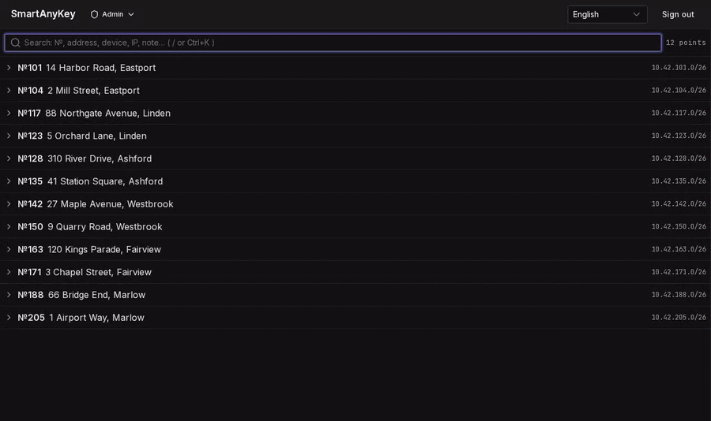
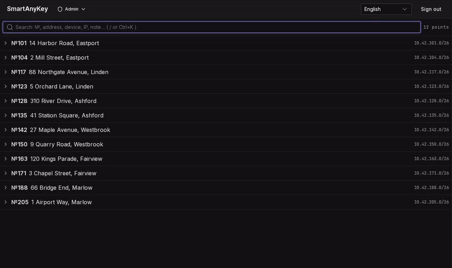
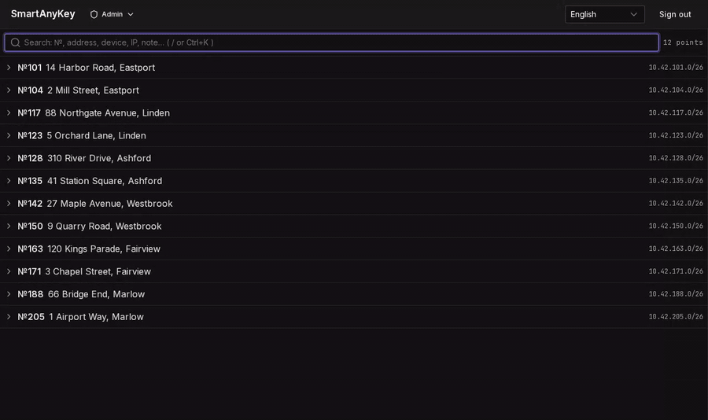
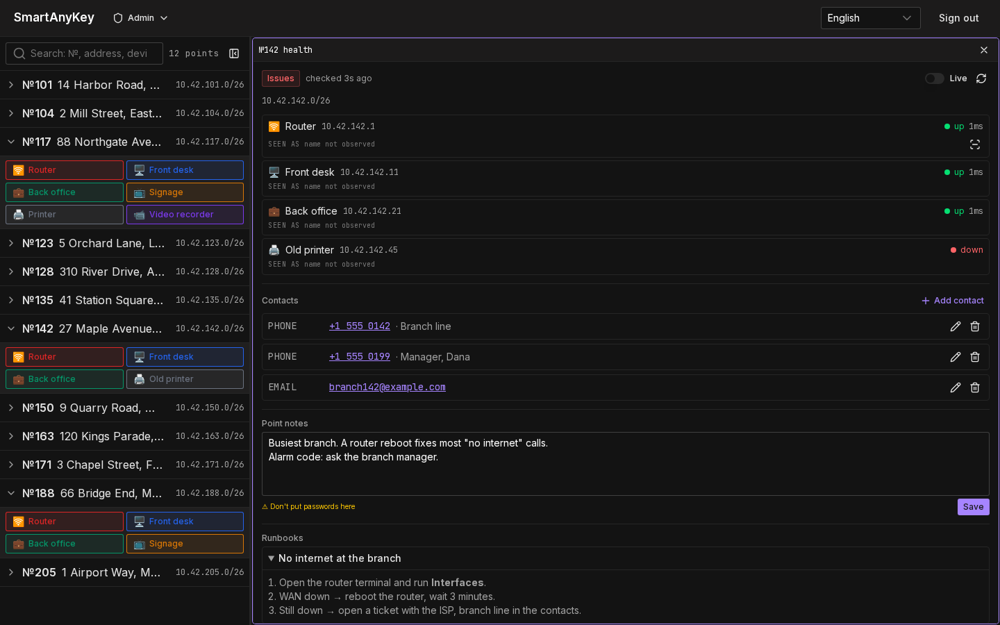
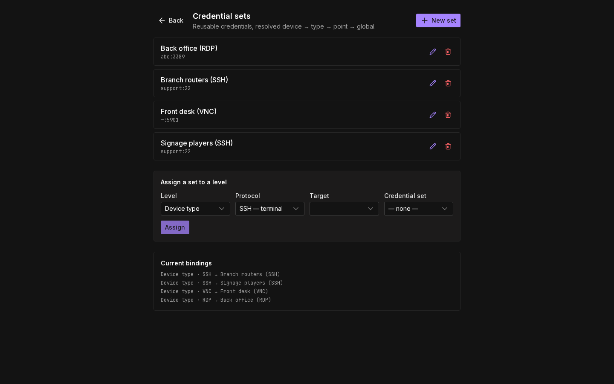
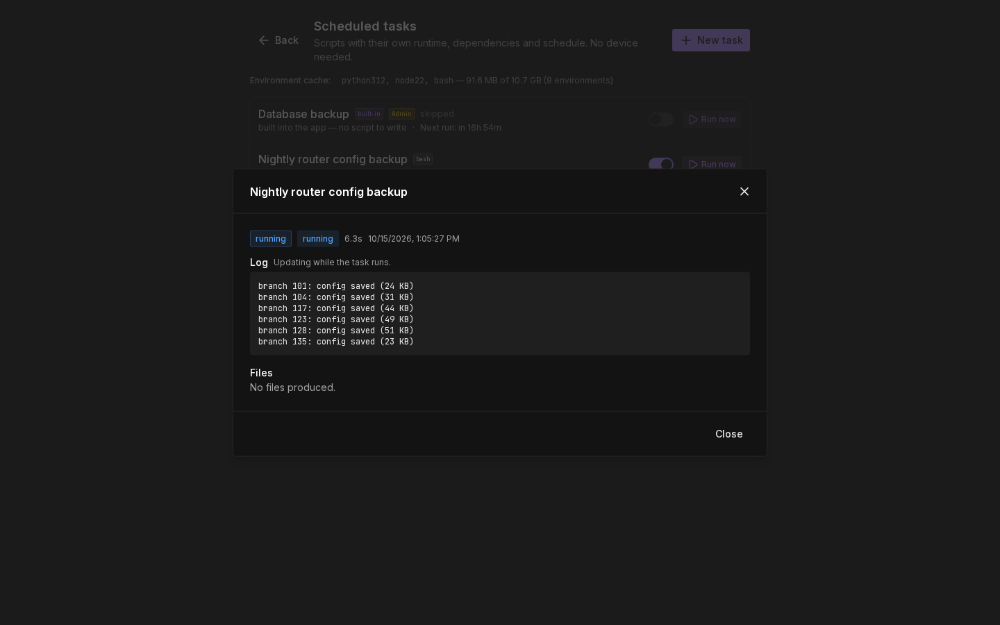
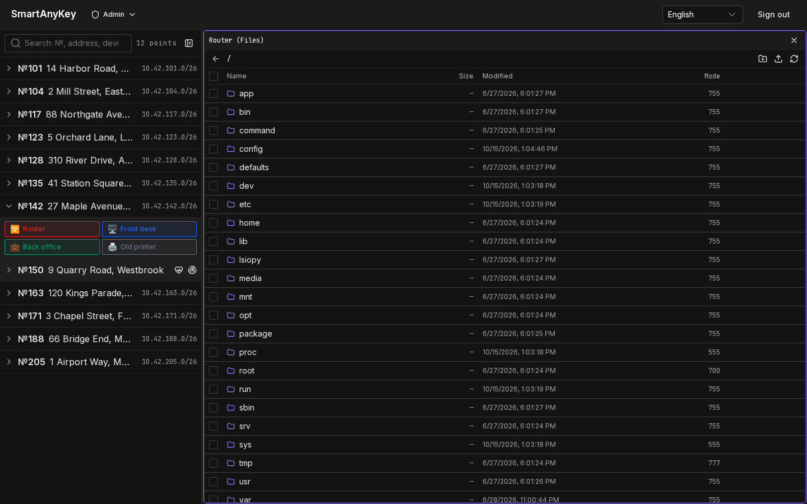
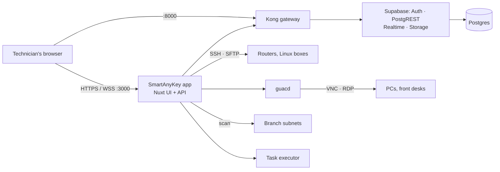

<div align="center">

# SmartAnyKey

**Self-hosted remote access for help desks that support many sites.**

Every branch, every device, one search box. Click — and you are on the machine,
in the browser, without typing a password.

[](./LICENSE)
[](https://github.com/darthGit/SmartAnyKey/releases)
[](https://github.com/darthGit?tab=packages&repo_name=SmartAnyKey)

**English** · [Українська](./README.uk.md)



</div>

## Why

A help desk that covers dozens or hundreds of branches lives on the phone. The
caller says "the front desk is frozen", and the technician has to find the branch,
find the machine, find the password, start the right client — while the caller
waits. SmartAnyKey turns that into one search and one click:

- **No client software and no VPN for the technician** — SSH, VNC and RDP open in
  the browser tab.
- **Nothing installed on the devices** — it speaks the protocols they already
  have. Routers, PCs, signage players, recorders stay as they are.
- **No password lookup** — credentials are stored encrypted and injected into
  the session; the technician never sees them.
- **Self-hosted** — one `docker compose` stack on your own server, inside your
  network.

## A call from branch 142

The branch line rings: *+1 555 0142*. The technician types the number — the
search matches it against branch contacts and opens the branch. One click on
**Router** gives a terminal; one click on **Front desk** gives its screen. The
GIF above is exactly that, recorded on the demo data that ships with the project.

## What you get

### Sessions side by side

Open SSH, VNC and RDP sessions next to each other and arrange them like
windows: drag a pane onto a neighbour's edge to split, drag the splitter to
resize. The terminal stays alive while the next session connects.



### Find what is on a branch network

Scan a branch's subnet and get a proposed diff: hosts that are new, matched,
changed or missing, each classified by **your** rules (ports, banners,
certificates). Nothing is written until you confirm — one click adds everything
that matched.



### Everything else the call needs

<table>
<tr>
<td width="50%">
<picture>
  <source media="(prefers-color-scheme: light)" srcset="docs/media/en/board-light.png">
  
</picture>
<p><b>Branch card.</b> Live device status, who to call, notes for the next
technician and runbooks that apply to the devices on this branch.</p>
</td>
<td width="50%">
<picture>
  <source media="(prefers-color-scheme: light)" srcset="docs/media/en/credentials-light.png">
  
</picture>
<p><b>Credentials once, for every branch.</b> Named credential sets resolved
device → type → branch → global. Encrypted at rest, decrypted only on the
server, every use logged.</p>
</td>
</tr>
<tr>
<td width="50%">
<picture>
  <source media="(prefers-color-scheme: light)" srcset="docs/media/en/tasks-light.png">
  
</picture>
<p><b>Scheduled tasks.</b> Your own Python, Node or shell scripts on a cron or a
webhook, with a live log, retries and files kept per run — nightly config
backups, reports, notifications.</p>
</td>
<td width="50%">
<picture>
  <source media="(prefers-color-scheme: light)" srcset="docs/media/en/files-light.png">
  
</picture>
<p><b>Files.</b> Browse, upload and download over SFTP on any SSH device, in the
same pane grid.</p>
</td>
</tr>
</table>

And: roles (viewer, operator, admin) enforced in the database and at the API,
commands in the device menu, CSV import, a drift inbox for scheduled rescans,
English and Ukrainian interface.

## Requirements

Measured on a clean install of v0.1.0 (nine containers, idle, no open sessions):

| | |
| :-- | :-- |
| Memory | ~0.9 GB in use |
| Disk | 3.8 GB of images, plus your data |
| Software | Docker with Compose v2 |

Each open graphical session adds load on `guacd` and the app; plan with headroom
— 2 GB of RAM is a sensible floor for a small team.

## Quickstart

You need a machine with Docker and Compose v2. Take the `docker/`
directory, run one script, open a browser — no source code, Node or pnpm.

```bash
# 1. Generate your own secrets, start the stack, wait until it is healthy.
#    Safe to re-run: an existing .env is never overwritten.
./docker/install.sh

# 2. Open the address the script prints, on port 3000.

# 3. Create the first administrator on the setup screen it shows you.
```

The schema is applied by the application on startup. Own registry, unattended
install, choosing the address, TLS and the full manual path:
**[docs/installation.md](docs/installation.md)**.

## Try it with a demo branch network

No devices to point it at yet? Add `--demo`:

```bash
./docker/install.sh --demo
```

Besides the normal install this starts a fictional branch office next to the
stack — a router and a signage player over SSH, a front-desk PC over VNC, a
back-office PC over RDP, a printer and a video recorder to discover — and loads
twelve demo branches with contacts and runbooks. Create the administrator, search
for `142`, click **Router**. It is what the GIFs on this page were recorded on.

The demo targets listen only inside the stack's network, but their passwords are
public: use demo mode to try SmartAnyKey, not on a real installation. Remove it
with `SAK_DEMO=` in `docker/.env` and a re-run of `./docker/install.sh`.

## Security model

SmartAnyKey holds the keys to every branch, so this is the part to read first.

- **Credentials** are encrypted with AES-256-GCM. The key lives in the
  environment, never in the database; passwords are decrypted only in the
  server's memory and never reach the browser. Every resolve and copy is written
  to an access log.
- **Roles** — viewer, operator, admin — are checked twice: by row-level security
  in Postgres and by the API before any session opens or command runs. There is
  no self-signup; administrators create users.
- **Two-factor sign-in** with an authenticator app (TOTP). The server enforces
  it — the API, the remote sessions and every table the browser reads — so a
  password alone gets nowhere once a user has set it up. Administrators must use
  it by default; see [Two-factor sign-in](#two-factor-sign-in).
- **Nothing on the devices.** Sessions use the protocols the devices already
  speak; no agent to install, update or trust.
- **Small surface.** Only the app (3000) and the API gateway (8000/8443) listen on
  the host; Postgres is reachable only inside the compose network.
- **Abuse limits.** Sign-in is rate-limited per client address, opening sessions
  per user.
- **Browser hardening.** Content-Security-Policy on every page, frame protection,
  HSTS once you run behind TLS.
- **Your scripts run apart.** Scheduled tasks execute in a separate executor
  container that has no database credentials.

### Two-factor sign-in

Each user turns it on under **Sign-in security** (top right of the board): scan
the QR code with Google Authenticator, Aegis, 1Password or a similar app, then
enter the 6-digit code. From then on every sign-in asks for a code.

**Who must use it** is set under **Admin → Users**: everyone, operators and
admins, admins only (the default on new and upgraded installs), or nobody. A
user under the policy who has no authenticator yet is taken to set one up right
after the password, and the server answers nothing else until they do. The
change applies from the next request.

**Lost phone.** An administrator presses **Reset 2FA** next to the user; the
user signs in with the password and sets up the app again. If the last
administrator lost theirs, run on the server:

```bash
docker compose -f docker/docker-compose.yml run --rm app node scripts/reset-mfa.mjs admin@example.com
```

Codes are time-based: keep the server clock synchronised (NTP), or valid codes
are rejected.

Found a vulnerability? Please report it privately — see [SECURITY.md](./SECURITY.md).

## How it works



Graphical sessions use Apache Guacamole's `guacd` with our own browser bridge;
terminals and file transfer go over SSH straight from the app. Both run inside
your network — the browser only ever talks to your server.

## How it compares

- **[Apache Guacamole](https://guacamole.apache.org/)** is the clientless VNC/RDP/SSH
  gateway SmartAnyKey's graphical sessions are built on. Guacamole gives you
  connections; SmartAnyKey adds the help-desk layer around them — branches,
  contacts, phone search, credential inheritance, network scans, tasks.
- **[RustDesk](https://github.com/rustdesk/rustdesk)** and
  **[MeshCentral](https://github.com/Ylianst/MeshCentral)** are remote-desktop and
  device-management tools with their own software on the managed machines.
  Choose them when you want an agent there; choose SmartAnyKey when the devices
  should stay untouched and the work is organised around sites.

<sub>Facts about other projects are taken from their own pages, checked October 2026.</sub>

## Status

**Works today:** everything above, one-command install from release images,
backup and restore, rate limiting, security headers, English and Ukrainian.

**Not yet:**

- Server error messages are in English only (the interface itself is translated).
- One-command rollback to the previous release, verified end to end.
- A browser smoke test in CI: sign in → board → open a session.

**Planned:**

- A board that stays fast with hundreds of sites.
- Accessibility pass: automated audit and full keyboard navigation.

Monitoring and error tracking are left to your own stack: the services expose
health checks, and logs go to Docker.

## Documentation

- [Installation](docs/installation.md) — options, TLS, the manual path
- [Operations](docs/operations.md) — upgrades, data, backup and restore
- [Development](docs/development.md) — running from source, demo data, releases
- [Architecture decisions](docs/DECISIONS.md)
- [Changelog](CHANGELOG.md) · [Contributing](CONTRIBUTING.md) · [Security](SECURITY.md)

## License

Apache License 2.0 — see [LICENSE](./LICENSE). Copyright 2026 darthGit.
