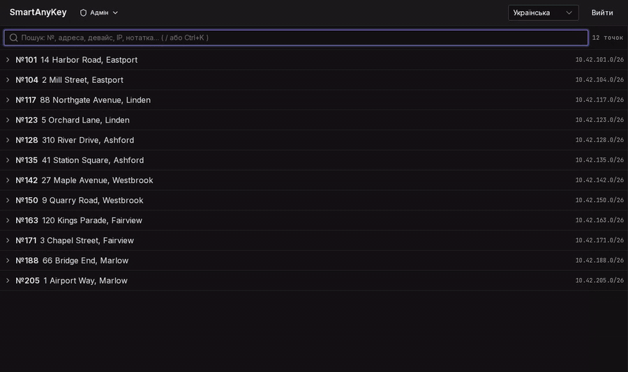
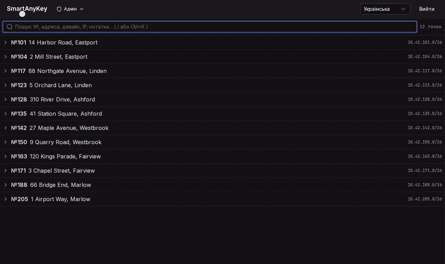
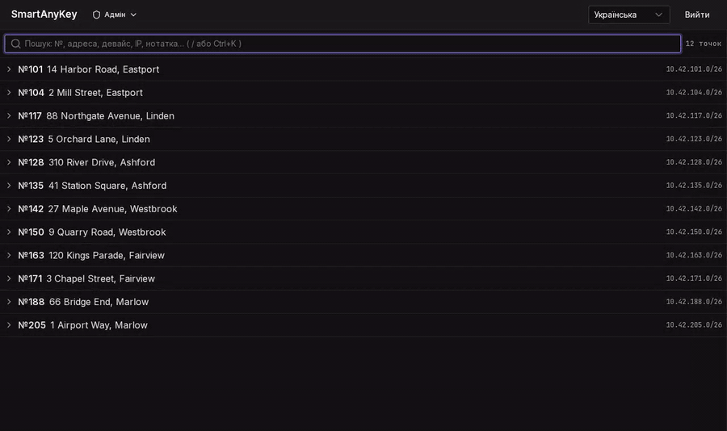
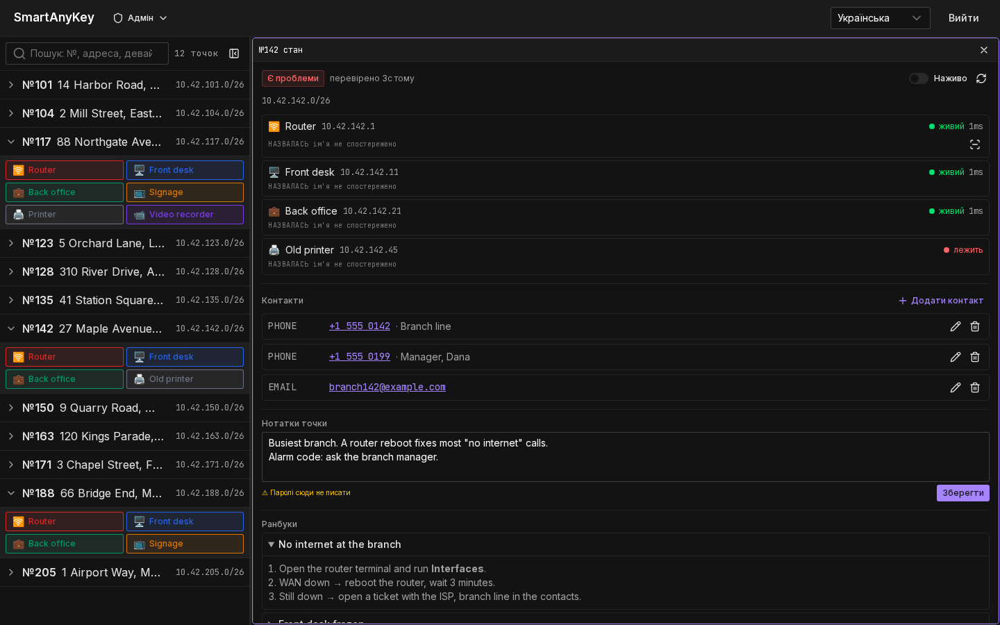
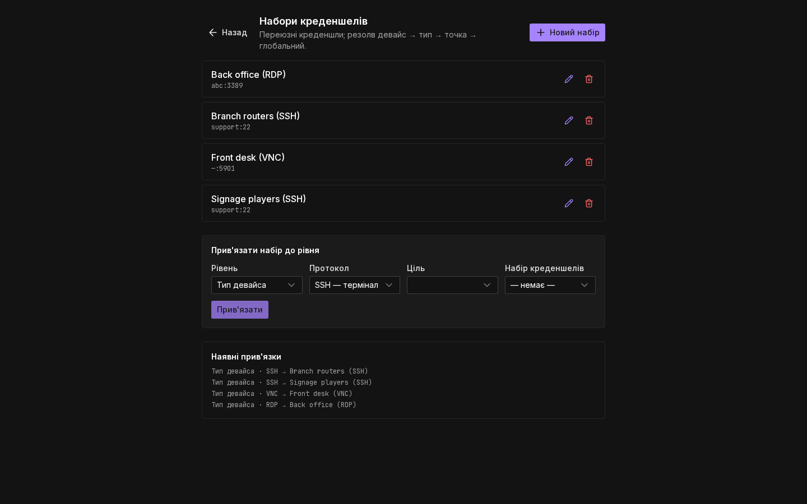
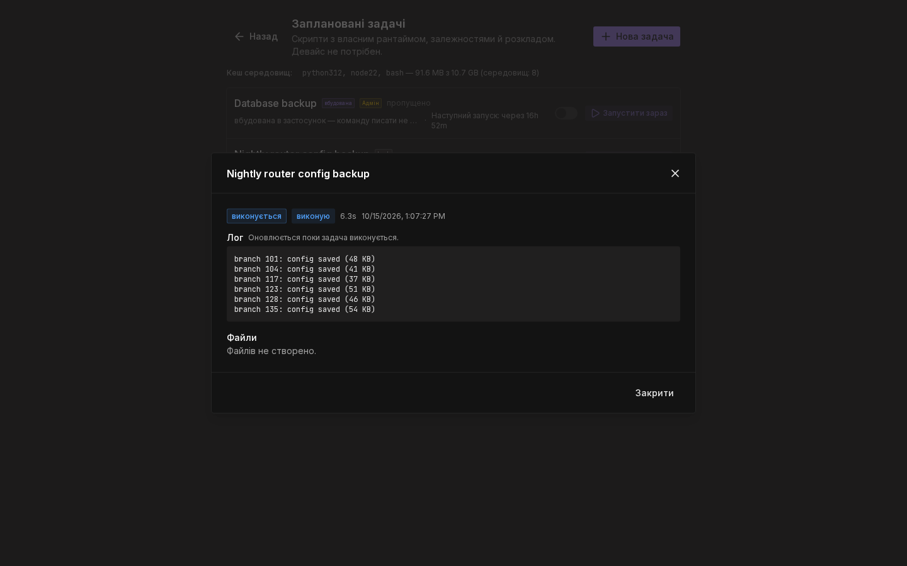
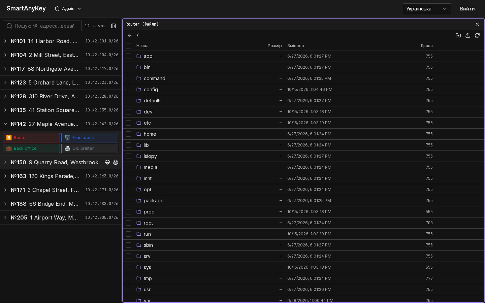
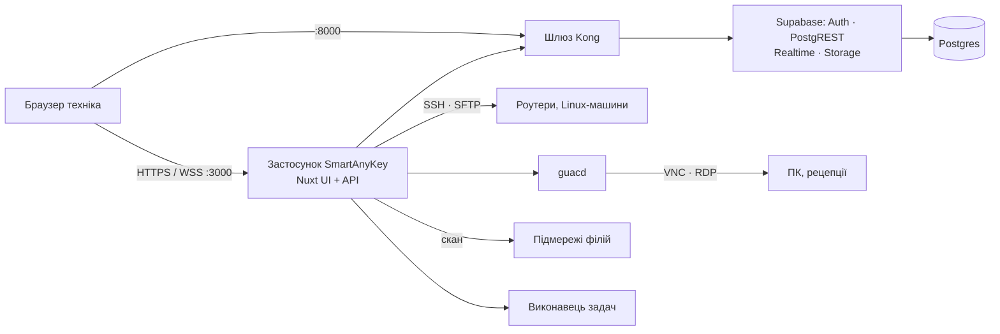

<div align="center">

# SmartAnyKey

**Віддалений доступ для служб підтримки, що обслуговують багато філій. На власному сервері.**

Кожна філія, кожен пристрій, одне поле пошуку. Клік — і ви вже на машині,
у браузері, без введення пароля.

[](./LICENSE)
[](https://github.com/darthGit/SmartAnyKey/releases)
[](https://github.com/darthGit?tab=packages&repo_name=SmartAnyKey)

[English](./README.md) · **Українська**



</div>

## Навіщо

Служба підтримки, що веде десятки чи сотні філій, живе на телефоні. Дзвонять:
«рецепція зависла», — і технік мусить знайти філію, знайти машину, знайти
пароль, запустити потрібний клієнт, поки людина чекає на лінії. SmartAnyKey
зводить це до одного пошуку й одного кліку:

- **Ні клієнтських програм, ні VPN у техніка** — SSH, VNC і RDP відкриваються у
  вкладці браузера.
- **Нічого не ставиться на пристрої** — система говорить протоколами, які в них
  уже є. Роутери, ПК, плеєри, реєстратори лишаються як є.
- **Без пошуку паролів** — облікові дані зберігаються зашифрованими й
  підставляються в сесію; технік їх не бачить.
- **На власному сервері** — один стек `docker compose` у вашій мережі.

## Дзвінок із філії 142

Дзвонить лінія філії: *+1 555 0142*. Технік вводить номер — пошук зіставляє його
з контактами філій і відкриває філію. Клік по **Router** — термінал; клік по
**Front desk** — її екран. GIF угорі — саме це, записане на демо-даних, що
постачаються з проєктом.

## Що є

### Сесії поруч

Відкривайте SSH, VNC і RDP поруч і розкладайте їх як вікна: перетягніть панель
на край сусідньої, щоб розділити, тягніть роздільник, щоб змінити розмір.
Термінал живе, поки підключається наступна сесія.



### Що є в мережі філії

Скануйте підмережу філії й отримуйте запропоновану різницю: нові, знайомі,
змінені та зниклі хости, кожен класифікований **вашими** правилами (порти,
банери, сертифікати). Нічого не записується без підтвердження — один клік додає
все, що впізнано.



### Решта, що потрібна під час дзвінка

<table>
<tr>
<td width="50%">
<picture>
  <source media="(prefers-color-scheme: light)" srcset="docs/media/uk/board-light.png">
  
</picture>
<p><b>Картка філії.</b> Живий стан пристроїв, кому дзвонити, нотатки для
наступного техніка й інструкції, що стосуються пристроїв цієї філії.</p>
</td>
<td width="50%">
<picture>
  <source media="(prefers-color-scheme: light)" srcset="docs/media/uk/credentials-light.png">
  
</picture>
<p><b>Облікові дані — раз для всіх філій.</b> Іменовані набори з успадкуванням
пристрій → тип → філія → глобально. Зашифровані, розшифровуються лише на
сервері, кожне використання в журналі.</p>
</td>
</tr>
<tr>
<td width="50%">
<picture>
  <source media="(prefers-color-scheme: light)" srcset="docs/media/uk/tasks-light.png">
  
</picture>
<p><b>Задачі за розкладом.</b> Ваші скрипти на Python, Node чи shell за cron
або вебхуком — з живим логом, повторами й файлами кожного прогону: нічні
бекапи конфігів, звіти, сповіщення.</p>
</td>
<td width="50%">
<picture>
  <source media="(prefers-color-scheme: light)" srcset="docs/media/uk/files-light.png">
  
</picture>
<p><b>Файли.</b> Перегляд, завантаження й вивантаження через SFTP на будь-якому
SSH-пристрої, у тій самій сітці панелей.</p>
</td>
</tr>
</table>

А ще: ролі (переглядач, оператор, адміністратор), перевірені і в базі, і в API;
команди в меню пристрою; імпорт CSV; вхідні про зміни між плановими сканами;
інтерфейс англійською та українською.

## Вимоги

Заміряно на чистому встановленні v0.1.0 (дев'ять контейнерів, у простої, без
відкритих сесій):

| | |
| :-- | :-- |
| Пам'ять | ~0,9 ГБ зайнято |
| Диск | 3,8 ГБ образів, плюс ваші дані |
| ПЗ | Docker з Compose v2 |

Кожна відкрита графічна сесія додає навантаження на `guacd` і застосунок; майте
запас — 2 ГБ RAM розумний мінімум для невеликої команди.

## Швидкий старт

Потрібна машина з Docker і Compose v2. Візьміть каталог `docker/`, запустіть
один скрипт, відкрийте браузер — без вихідного коду, Node чи pnpm.

```bash
# 1. Згенерувати власні секрети, запустити стек, дочекатися готовності.
#    Безпечно запускати повторно: наявний .env не перезаписується.
./docker/install.sh

# 2. Відкрийте адресу, яку надрукує скрипт, порт 3000.

# 3. Створіть першого адміністратора на екрані налаштування.
```

Схему застосовує сам застосунок під час старту. Власний реєстр, встановлення без
участі людини, вибір адреси, TLS і повний ручний шлях — у
**[docs/installation.md](docs/installation.md)** (англійською).

## Спробувати на демо-мережі філій

Ще нема пристроїв, до яких підключитися? Додайте `--demo`:

```bash
./docker/install.sh --demo
```

Крім звичайного встановлення це запускає поруч зі стеком вигадану філію — роутер і
плеєр вивісок через SSH, ПК рецепції через VNC, ПК бек-офісу через RDP, принтер і
відеореєстратор для автовизначення — і завантажує дванадцять демо-філій з
контактами й інструкціями. Створіть адміністратора, знайдіть `142`, клікніть
**Router**. Саме на цьому записані GIF на цій сторінці.

Демо-цілі слухають лише всередині мережі стеку, але їхні паролі публічні:
демо-режим — щоб спробувати SmartAnyKey, не для справжнього встановлення.
Вимкнути — `SAK_DEMO=` у `docker/.env` і повторний запуск `./docker/install.sh`.

## Модель безпеки

SmartAnyKey тримає ключі від кожної філії, тож цей розділ варто прочитати першим.

- **Облікові дані** шифруються AES-256-GCM. Ключ живе в оточенні, ніколи в базі;
  паролі розшифровуються лише в пам'яті сервера й ніколи не потрапляють у
  браузер. Кожне отримання й копіювання пишеться в журнал доступу.
- **Ролі** — переглядач, оператор, адміністратор — перевіряються двічі: політиками
  рядків у Postgres і API перед відкриттям будь-якої сесії чи запуском команди.
  Самореєстрації немає; користувачів створюють адміністратори.
- **Нічого на пристроях.** Сесії йдуть протоколами, які пристрої вже мають; жодного
  агента, який треба ставити, оновлювати й якому треба довіряти.
- **Мала поверхня.** На хості слухають лише застосунок (3000) і API-шлюз
  (8000/8443); Postgres доступний лише всередині мережі compose.
- **Обмеження зловживань.** Вхід обмежено за адресою клієнта, відкриття сесій — за
  користувачем.
- **Захист у браузері.** Content-Security-Policy на кожній сторінці, захист від
  вбудовування у фрейми, HSTS, щойно ви працюєте за TLS.
- **Ваші скрипти окремо.** Задачі виконуються в окремому контейнері, що не має
  облікових даних бази.

Знайшли вразливість? Повідомте приватно — див. [SECURITY.md](./SECURITY.md).

## Як це працює



Графічні сесії йдуть через `guacd` з Apache Guacamole і наш власний міст у
браузер; термінали й передача файлів — через SSH прямо із застосунку. Усе це
працює у вашій мережі — браузер спілкується лише з вашим сервером.

## Порівняння

- **[Apache Guacamole](https://guacamole.apache.org/)** — безклієнтський шлюз
  VNC/RDP/SSH, на якому побудовані графічні сесії SmartAnyKey. Guacamole дає
  підключення; SmartAnyKey додає навколо них шар служби підтримки — філії,
  контакти, пошук за телефоном, успадкування облікових даних, скани мережі, задачі.
- **[RustDesk](https://github.com/rustdesk/rustdesk)** і
  **[MeshCentral](https://github.com/Ylianst/MeshCentral)** — інструменти
  віддаленого робочого столу й керування пристроями з власною програмою на
  керованих машинах. Обирайте їх, коли там потрібен агент; обирайте SmartAnyKey,
  коли пристрої мають лишитися недоторканими, а робота організована навколо філій.

<sub>Факти про інші проєкти взято з їхніх власних сторінок, перевірено в жовтні 2026.</sub>

## Стан

**Працює зараз:** усе вище, встановлення однією командою з релізних образів,
бекап і відновлення, обмеження частоти запитів, захисні заголовки, англійська й
українська.

**Ще ні:**

- Повідомлення сервера про помилки лише англійською (сам інтерфейс перекладено).
- Відкат до попереднього релізу однією командою, перевірений від початку до кінця.
- Браузерний smoke-тест у CI: вхід → борд → відкриття сесії.

**У планах:**

- Борд, що лишається швидким на сотнях філій.
- Доступність: автоматичний аудит і повна навігація з клавіатури.

Моніторинг і відстеження помилок — на вашому стеку: сервіси мають health-перевірки,
логи йдуть у Docker.

## Документація (англійською)

- [Installation](docs/installation.md) — варіанти, TLS, ручний шлях
- [Operations](docs/operations.md) — оновлення, дані, бекап і відновлення
- [Development](docs/development.md) — запуск із сирців, демо-дані, релізи
- [Architecture decisions](docs/DECISIONS.md)
- [Changelog](CHANGELOG.md) · [Contributing](CONTRIBUTING.md) · [Security](SECURITY.md)

## Ліцензія

Apache License 2.0 — див. [LICENSE](./LICENSE). Copyright 2026 darthGit.
